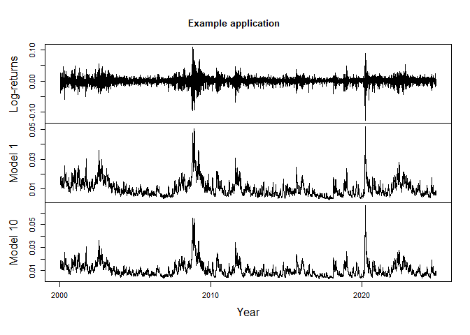
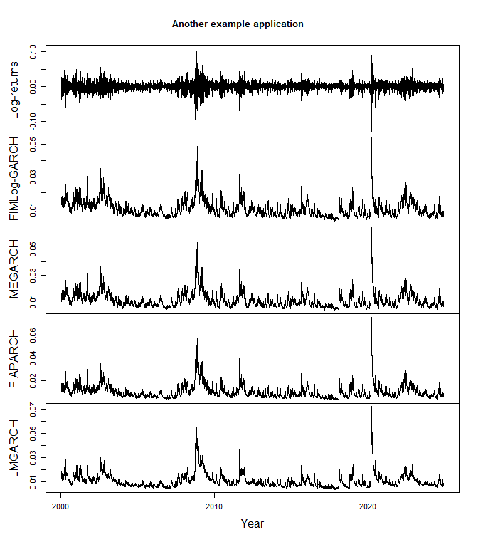

<!-- README.md is generated from README.Rmd. Please edit that file -->

# fEGarch 

<!-- badges: start -->

[](https://cran.r-project.org/package=fEGarch)
[](https://cran.r-project.org/package=fEGarch)
[](https://cran.r-project.org/package=fEGarch)
[](https://cran.r-project.org/web/licenses/GPL-3)
<!-- badges: end -->

The goal of `fEGarch` is to provide easy access to a broad family of
exponential generalized autoregressive conditional heteroskedasticity
(EGARCH) models both with either short or long memory. The six most
common conditional distributions, i.e. a normal distribution, a
$t$-distribution, a generalized error distribution, and the skewed
variants of those three, are available. Furthermore, we introduce the
average Laplace distribution and its skewed variant as newly selectable
conditional distributions for the EGARCH family models. Overall, the
EGARCH family models are a strong competition to well-established
GARCH-type models and provide new ways to estimate conditional
volatilities, while making the prominent EGARCH and fractionally
integrated EGARCH (FIEGARCH) available as special cases. For convenience
and the purpose of comparison, fractionally integrated asymmetric power
ARCH (FIAPARCH) and long-memory GARCH (LMGARCH) models are available as
well for estimation.

## Installation

You can install the current version of the package from CRAN with:

``` r
install.packages("fEGarch")
```

## Examples

### Basic applications

This is a basic example which shows you how to fit a model of the EGARCH
family to the Standard and Poor’s 500 daily log-returns.

At first, specify a model from the EGARCH family using `fEGarch_spec()`.

``` r
library(fEGarch)

### 1. Set model specification via "fEGarch_spec()"
spec1 <- fEGarch_spec(
  model_type = "eGARCH",       # the basic model type among EGARCH and
                               # Log-GARCH as subclasses of the EGARCH family;
  orders = c(1, 1),            # the model orders;
  long_memo = TRUE,            # include long memory?;
  cond_dist = "norm",          # the conditional distribution;
  powers = c(0, 0),            # powers of the asymmetry and magnitude terms, respectively;
  modulus = c(TRUE, TRUE)      # whether or not to apply a modulus transformation
                               # to the asymmetry and magnitude terms, respectively
)

# -> Specification now aligns with that of FIMLog-GARCH(1, 1) with
#    conditional normal distribution
```

Afterwards, use the model specification returned by `fEGarch_spec()`
together with your data object and apply the estimation function
`fEGarch()` to them.

``` r
### 2. Use specification to fit model to data
rt <- SP500
model1 <- fEGarch(spec1, rt)
model1
#> *************************************
#> *     Fitted EGARCH Family Model    *
#> *************************************
#>  
#> Type: eGARCH
#> Orders: (1, 1)
#> Modulus: (TRUE, TRUE)
#> Powers: (0, 0)
#> Long memory: TRUE
#> Cond. distribution: norm
#>  
#> ARMA orders (cond. mean): (0, 0)
#> Long memory (cond. mean): FALSE
#> 
#> Fitted parameters:
#> 
#>               par     se     tval   pval
#> mu         0.0003 0.0001   4.2392 0.0000
#> omega_sig -8.6599 0.1394 -62.1382 0.0000
#> phi1       0.8680 0.0241  36.0575 0.0000
#> kappa     -0.2362 0.0155 -15.2780 0.0000
#> gamma      0.3194 0.0208  15.3494 0.0000
#> d          0.2754 0.0415   6.6391 0.0000
#>  
#> Information criteria:
#> AIC: -6.4945, BIC: -6.4880
```

Using the model description in the documentation of `fEGarch_spec()`,
the fitted model following the previous estimation results is
$$r_t = 0.0003 + \sigma_t\eta_t \hspace{3mm} \text{with} \hspace{3mm} \eta_t \sim N(0,1), \hspace{3mm} \text{where}$$
$$\ln\left(\sigma_t^2\right)=-8.6599 + (1-0.8680 B)^{-1}(1-B)^{-0.2754}g\left(\eta_{t-1}\right) \hspace{3mm}\text{with}$$
$$g\left(\eta_{t-1}\right)=-0.2362\left[g_a\left(\eta_{t-1}\right)-E\left[g_a\left(\eta_{t-1}\right)\right]\right] + 0.3194\left[g_m\left(\eta_{t-1}\right)-E\left[g_m\left(\eta_{t-1}\right)\right]\right], \hspace{3mm}\text{where}$$
$$g_a\left(\eta_{t-1}\right)=\text{sgn}\left(\eta_{t-1}\right)\ln\left(\left|\eta_{t-1}\right|+1\right)\hspace{3mm}\text{and}$$
$$g_m\left(\eta_{t-1}\right)=\ln\left(\left|\eta_{t-1}\right|+1\right).$$

A convenient way to implement various specific model specifications is
available via a selection of wrappers for `fEGarch_spec()`. They all
only have the function arguments `orders` and `cond_dist` from
`fEGarch_spec()`.

``` r
### 3. Use shortcuts for submodel specifications
spec2 <- megarch_spec()         # Specification for MEGARCH
spec3 <- mloggarch_spec()       # Specification for MLog-GARCH
spec4 <- egarch_spec()          # Specification for EGARCH
spec5 <- loggarch_spec()        # Specification for Log-GARCH
spec6 <- fiegarch_spec()        # Specification for FIEGARCH
spec7 <- filoggarch_spec()      # Specification for FILog-GARCH
spec8 <- fimloggarch_spec()     # Specification for FIMLog-GARCH
spec9 <- fimegarch_spec()       # Specification for FIMEGARCH

# -> All with adjustable arguments "orders" and "cond_dist".

spec10 <- megarch_spec(orders = c(2, 1), cond_dist = "std")
```

They can all be used in `fEGarch()`. In the following, the previously
created model specification `spec9` is considered for the log-returns.
The other specifications can be applied analogously.

``` r
model10 <- fEGarch(spec10, rt)   # ... and so on for other specifications
model10
#> *************************************
#> *     Fitted EGARCH Family Model    *
#> *************************************
#>  
#> Type: eGARCH
#> Orders: (2, 1)
#> Modulus: (TRUE, FALSE)
#> Powers: (0, 1)
#> Long memory: FALSE
#> Cond. distribution: std
#>  
#> ARMA orders (cond. mean): (0, 0)
#> Long memory (cond. mean): FALSE
#> 
#> Fitted parameters:
#> 
#>               par     se     tval   pval
#> mu         0.0004 0.0001   3.5822 0.0003
#> omega_sig -9.3706 0.1136 -82.5099 0.0000
#> phi1       0.9797 0.2122   4.6167 0.0000
#> phi2      -0.0036 0.2056  -0.0176 0.9860
#> kappa     -0.2945 0.0666  -4.4238 0.0000
#> gamma      0.1654 0.0268   6.1794 0.0000
#> df         7.0254 0.6843  10.2669 0.0000
#>  
#> Information criteria:
#> AIC: -6.5387, BIC: -6.5312
```

As a further extension, dual-models with autoregressive moving-average
(ARMA) model or fractionally integrated ARMA (FARIMA / ARFIMA) model in
the conditional mean simultaneously with error process from the EGARCH
family can be defined and estimated. For this purpose, the `mean_spec()`
function must be utilized in addition to the previous steps.

``` r
spec_egarch <- egarch_spec()
spec_arma <- mean_spec(
  orders = c(1, 1),     # ARMA orders
  long_memo = FALSE,    # Long-memory?
  include_mean = TRUE   # Estimate uncond. mean?
)
model11 <- fEGarch(
  spec = spec_egarch,
  rt = rt,
  meanspec = spec_arma
)
model11
#> *************************************
#> *     Fitted EGARCH Family Model    *
#> *************************************
#>  
#> Type: eGARCH
#> Orders: (1, 1)
#> Modulus: (FALSE, FALSE)
#> Powers: (1, 1)
#> Long memory: FALSE
#> Cond. distribution: norm
#>  
#> ARMA orders (cond. mean): (1, 1)
#> Long memory (cond. mean): FALSE
#> 
#> Fitted parameters:
#> 
#>               par     se      tval   pval
#> mu         0.0003 0.0001    2.8757 0.0040
#> ar1        0.2296 0.2798    0.8206 0.4119
#> ma1       -0.2801 0.2731   -1.0256 0.3051
#> omega_sig -9.1303 0.0772 -118.2882 0.0000
#> phi1       0.9719 0.0028  349.1268 0.0000
#> kappa     -0.1339 0.0081  -16.5671 0.0000
#> gamma      0.1617 0.0123   13.1245 0.0000
#>  
#> Information criteria:
#> AIC: -6.4969, BIC: -6.4894
```

### Illustrations

Estimation objects returned by `fEGarch()` contain several elements.
They can be either accessed through the operator `@` or via specific
accessor functions named after the corresponding elements in the output
object.

``` r
sigt1 <- sigt(model1)
sigt10 <- model10@sigt
TS <- cbind(
  "Log-returns" = rt,
  "Model 1" = sigt1,
  "Model 10" = sigt10
)
```

If the input data is formatted as a time series object of class `"zoo"`,
`fEGarch()` applies the same formatting to all output series in its
returned object, also to the estimated conditional standard deviations.

``` r
plot(TS, xlab = "Year", main = "Example application")
```


Furthermore, also the conditional means of the previously estimated
`model11` object can be obtained.

``` r
cond11 <- cmeans(model11)
sig11 <- sigt(model11)

plot.zoo <- get("plot.zoo", envir = asNamespace("zoo"))

obj <- cbind(
  "Log-returns" = rt,
  "Conditional means" = cond11,
  "Conditional SDs" = sig11
)
plot.zoo(obj, screens = c(1, 1, 2), col = c(1, 2, 1),
  main = paste0(
    "Log-returns with estimated conditional means\n",
    "and estimated conditional standard deviations"
  ),
  xlab = "Year"
)
```



### Alternatives

The `fEGarch` package also allows for the estimation of FIAPARCH and
LMGARCH models, however, currently only with fixed model orders $p=q=1$.
For these two models, there are two fitting functions `lmgarch()` and
`fiaparch()` available without any preceding model specification steps.
Model specifications can be made via arguments within these functions
directly.

``` r
model_fiaparch <- fiaparch(rt, orders = c(1, 1), cond_dist = "std")
model_lmgarch <- lmgarch(rt, orders = c(1, 1), cond_dist = "std")

model_fiaparch
#> *************************************
#> *       Fitted FIAPARCH Model       *
#> *************************************
#>  
#> Type: fiapARCH
#> Orders: (1, 1)
#> Long memory: TRUE
#> Cond. distribution: std
#>  
#> ARMA orders (cond. mean): (0, 0)
#> Long memory (cond. mean): FALSE
#>  
#> Fitted parameters:
#> 
#>          par      se   tval   pval
#> mu    0.0004  0.0088 0.0491 0.9608
#> omega 0.0002  0.0250 0.0087 0.9931
#> phi1  0.1796  0.3601 0.4986 0.6181
#> beta1 0.4952  3.7868 0.1308 0.8960
#> gamma 1.0000  1.1617 0.8608 0.3893
#> delta 1.2438  7.0383 0.1767 0.8597
#> d     0.3959  4.5456 0.0871 0.9306
#> df    7.8299 21.5866 0.3627 0.7168
#>  
#> Information criteria:
#> AIC: -6.5484, BIC: -6.5398
```

``` r
sigt_fiaparch <- sigt(model_fiaparch)
sigt_lmgarch <- sigt(model_lmgarch)
TS2 <- cbind(
  "Log-returns" = rt,
  "FIMLog-GARCH" = sigt1,
  "MEGARCH" = sigt10,
  "FIAPARCH" = sigt_fiaparch,
  "LMGARCH" = sigt_lmgarch
)

plot(TS2, xlab = "Year", main = "Another example application", nc = 1)
```



## Main functions

The main functions of the package are:

- `fEGarch_spec()`: general EGARCH family model specification,

- `fEGarch()`: fitting function for models of the broader EGARCH family,

- `fiaparch()`: FIAPARCH model fitting,

- `lmgarch()`: LMGARCH model fitting,

- `fEGarch_sim()`: EGARCH family simulation,

- `fiaparch_sim()`: FIAPARCH simulation,

- `mean_spec()`: ARMA or FARIMA model specification for simultaneously
  modelling the conditional mean,

- `predict()`: a forecasting method to compute multistep point forecasts
  of the conditional mean and the conditional standard deviation
  following one of the package’s fitted models,

- `predict_roll()`: a method to compute rolling point forecasts of the
  conditional mean and the conditional standard deviation over a test
  set following one of the package’s fitted models.

The package, however, provides many other useful functions for you to
discover.

## Datasets

The package contains an example time series `SP500`, namely the Standard
and Poor’s 500 daily log-return series from January 04, 2000, until
November 30, 2024, obtained from Yahoo Finance. The series is formatted
as a time series object of class `"zoo"`.

## Authors

- Dominik Schulz (Department Economics, Paderborn University, Germany)
  (Author, Maintainer)

- Yuanhua Feng (Department Economics, Paderborn University, Germany)
  (Author)

- Christian Peitz (formerly: Department Economics, Paderborn University,
  Germany) (Author)

- Oliver Kojo Ayensu (Department Economics, Paderborn University,
  Germany) (Author)

## Contact

For questions, bug reports, etc., please contact the maintainer
Mr. Dominik Schulz via <dominik.schulz@uni-paderborn.de>.
